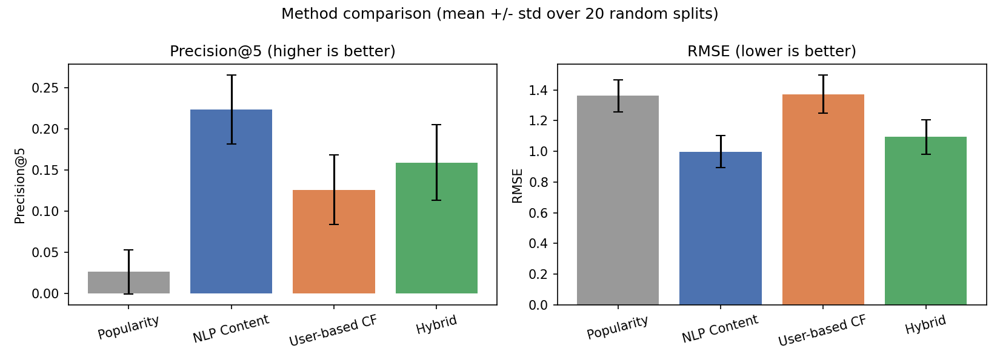
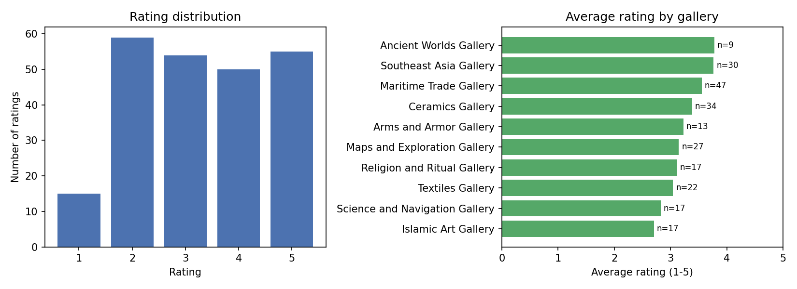

# Museum Exhibit and Cultural Site Recommender

| | |
|---|---|
| **Student** | Lương Chí Kiệt |
| **Student ID** | 29211354053 |
| **Section** | CS467C (No. 08) |
| **Course** | CS467 Advanced Artificial Intelligence, Duy Tan University, 2026-2027 |
| **Instructor** | Puri Vikram |
| **Project** | MP-C08, Museum Exhibit and Cultural Site Recommender (Cultural Heritage and Museums) |
| **Assignment** | Assignment 15: NLP and Basics of Recommendation Systems |

## 1. Problem Statement

Museum visitors with limited time want a short, personalised route focused on topics they find interesting. This project builds an exhibit recommender that combines **NLP on exhibit placard text** with **visitor ratings** to suggest a Top-5 mini-tour, explain *why* each exhibit was suggested (matching keywords), and handle brand-new exhibits that nobody has rated yet.

## 2. Dataset Description

Both files are **synthetic**. No public dataset exists for museum visitor ratings, so I created them for this project.

| File | Content |
|---|---|
| `data/items.csv` | 38 exhibits (`item_id, exhibit_title, gallery_wing, era, placard_text, theme_tags`) across 10 galleries: maritime trade, maps, ceramics, textiles, arms and armor, religion and ritual, Southeast Asia, Islamic art, ancient worlds, science and navigation. Placards are short (about 27 words on average) and written by hand, inspired by real types of museum objects. They are illustrative and not factual catalogue entries. |
| `data/ratings.csv` | 13 visitors, 233 ratings (`user_id, item_id, rating 1-5, visitor_comment`). Each visitor has a "taste" (for example maritime, ceramics, textiles, warfare, religion, Vietnam/bronze) that drives higher ratings for matching exhibits, plus noise. Rating counts: 1 star = 15, 2 = 59, 3 = 54, 4 = 50, 5 = 55. |

**Data quality check:** each visitor rated 14-22 exhibits, the user-item matrix is **52.8% empty** (target 40%-65%), and every exhibit has at least 2 ratings (needed for the popularity threshold).

A newly opened temporary exhibit (`E39`, placard text only, no ratings) is defined in `src/main.py` and used for the cold-start test.

**Limitation of synthetic ratings:** because ratings were generated from keyword-based tastes, content-based methods have a built-in advantage. Keep this in mind when reading the results.

## 3. NLP and Recommendation Methods

### NLP (`src/nlp_pipeline.py`)
1. **Preprocessing:** lowercase, remove punctuation and digits, collapse spaces, tokenize, remove stop words (scikit-learn list + a few museum filler words), light plural normalisation (`ships` becomes `ship`).
2. **Document per exhibit:** placard text + theme tags (tags repeated twice to give them more weight).
3. **TF-IDF:** unigrams + bigrams, sublinear term frequency (`TfidfVectorizer`).
4. **Query vectorisation:** `transform_text()` maps any free-text query or new exhibit description into the *same* vocabulary fitted on the dataset.
5. **Keyword explanations:** `explain_match()` returns the terms with the largest contribution to the cosine similarity between the query/user profile and an exhibit.
6. **Sentiment helper:** a small lexicon score for visitor comments (`sentiment_score`).

### Recommenders (`src/recommender.py`)
| Method | How it works |
|---|---|
| **Popularity baseline** | Weighted rating `(v/(v+m))·R + (m/(v+m))·C` where `R` is the item mean, `v` the rating count, `C` the global mean, `m = 2` (minimum count). Items already visited are removed. |
| **NLP content-based** | Cosine similarity between TF-IDF vectors. For a visitor, the profile is the rating-weighted sum of TF-IDF vectors of exhibits they liked (rating > 3). Also supports free-text queries and item-to-item similarity. |
| **User-based CF** | Cosine similarity between visitors on mean-centred ratings; prediction = `mean_u + Σ sim(u,v)·(r_vi − mean_v) / Σ|sim|` over the top-5 most similar visitors who rated item `i`. |
| **Hybrid** | `0.5·CF + 0.5·content` after min-max scaling both to [0, 1]. Exhibits with no CF signal (new exhibits) use the content score only. |

## 4. Installation and Run Commands

```bash
git clone https://github.com/<your-github-username>/cs467-miniproject-29211354053.git
cd cs467-miniproject-29211354053
python -m venv venv
venv\Scripts\activate          # Windows (macOS/Linux: source venv/bin/activate)
pip install -r requirements.txt

python src/main.py             # runs the 3 test cases, saves results/sample_outputs.txt
python src/evaluate.py         # offline evaluation, saves charts and tables to results/
```

Interactive options:

```bash
python src/main.py --user U07 --method hybrid     # popularity | content | cf | hybrid
python src/main.py --query "silk road textiles"
python src/main.py --similar E08
```

## 5. Sample Outputs for the 3 Required Test Cases

Full output is saved in [`results/sample_outputs.txt`](results/sample_outputs.txt).

### Test case 1: Theme query
Query: *"ancient maritime trade, traditional ceramics, and maps"*

| Rank | Exhibit | Score | Matching keywords |
|---|---|---|---|
| 1 | E08 Shipwreck Cargo: Salvaged Trade Goods | 0.214 | maritime trade, ceramic, maritime, trade |
| 2 | E10 Ming Dynasty Coastal Map | 0.188 | map, trade, maritime |
| 3 | E04 Hoi An Harbor Scroll | 0.186 | maritime trade, maritime, trade, ceramic |
| 4 | E03 Logbook of a Spice Voyage | 0.171 | maritime trade, trade, maritime |
| 5 | E06 Manila Galleon Cargo Manifest | 0.159 | maritime trade, maritime, trade |

### Test case 2: Returning visitor (U07)
U07 rated 15 exhibits; favourites include the Chinese Junk Model, Silk Road Caravan Route Map, Celestial Star Chart and Portuguese Navigator's Astrolabe. Hybrid Top-5 of **unvisited** exhibits:

| Rank | Exhibit | Score | Matching keywords |
|---|---|---|---|
| 1 | E04 Hoi An Harbor Scroll | 0.609 | trade, maritime, maritime trade, merchant, harbor |
| 2 | E18 Kendi Water Vessel | 0.600 | trade, ship, vessel, pottery, asia |
| 3 | E08 Shipwreck Cargo: Salvaged Trade Goods | 0.506 | trade, maritime, archaeology, maritime trade, bronze |
| 4 | E09 Venetian Portolan Chart | 0.503 | maritime, map, navigation, chart, sea |
| 5 | E10 Ming Dynasty Coastal Map | 0.491 | trade, map, maritime, china, chinese |

The demo also prints Popularity, Content and CF rankings for the same visitor and verifies that no recommended exhibit was already visited.

### Test case 3: Cold-start
A new temporary exhibit **E39 "Cargo of the Ca Mau Shipwreck"** is added with placard text only (0 ratings), using the already fitted vocabulary.

| Check | Result |
|---|---|
| E39 in top-5 for the theme query **before** it was added | False |
| E39 in top-5 for the theme query **after** | **True (rank 1, score 0.319)** |
| E39 in U07's hybrid top-5 | **True (rank 1)** |
| E39 in the popularity baseline top-5 | False (no ratings, so popularity cannot see it) |

Note: in the hybrid, a new exhibit has no CF score, so it is ranked by its content score alone. This is an intentional fallback, not evidence that the CF part "knows" the new exhibit.

## 6. Evaluation Results

**Protocol:** for each visitor, 3 ratings are hidden. The recommender is trained on the rest and ranks unvisited exhibits. Precision@5 counts how many of the top-5 are hidden exhibits the visitor liked (rating >= 4). RMSE and MAE are computed on the hidden ratings. Results are averaged over **20 random splits** (seeds 0-19) because the dataset is small.

| Method | Precision@5 | RMSE | MAE |
|---|---|---|---|
| Popularity | 0.026 | 1.362 | 1.167 |
| NLP Content-Based | **0.224** | **0.999** | **0.782** |
| User-based CF | 0.125 | 1.368 | 1.099 |
| Hybrid | 0.158 | 1.092 | 0.859 |




With only 3 hidden ratings per visitor, the maximum possible Precision@5 is well below 1 (about 0.4-0.6), so 0.22 is not as low as it looks. Error bars in the chart show the standard deviation over splits.

## 7. Short Reflection

**What worked well**
- The TF-IDF content-based recommender gives sensible, explainable results: every suggestion comes with the keywords that matched, which is easy to check by eye.
- Free-text queries and cold-start exhibits work without retraining, because new text is projected into the same vocabulary.
- The pipeline is small and runs in a few seconds.

**Limitations**
- **The data is synthetic and small** (13 visitors, 233 ratings). Ratings were generated from keyword-based tastes, so content-based methods are favoured by construction. The ranking of methods here should not be taken as a general conclusion.
- **Content-based beat the hybrid.** User-based CF has little signal with so few visitors, and averaging it with content lowered the score. The differences between Content and Hybrid are within about one standard deviation, so they are not clearly significant.
- Popularity performs poorly because visitors have very different tastes.
- Plural-only stemming is crude (for example, "ceremonies" becomes "ceremonie"). A real stemmer or lemmatiser would be cleaner.
- Hybrid weight (0.5), number of neighbours (5) and the minimum rating count (2) were not tuned.

**Possible improvements:** use a larger real dataset, tune the hybrid weight, add sentence embeddings instead of TF-IDF, and use visitor comments (sentiment) as an extra signal.

## 8. Project Structure

```
cs467-miniproject-29211354053/
|-- README.md
|-- requirements.txt
|-- .gitignore
|-- data/        items.csv, ratings.csv
|-- src/         nlp_pipeline.py, recommender.py, evaluate.py, main.py
`-- results/     sample_outputs.txt, method_comparison.png, rating_distribution.png,
                 evaluation_summary.csv, evaluation_raw.csv
```